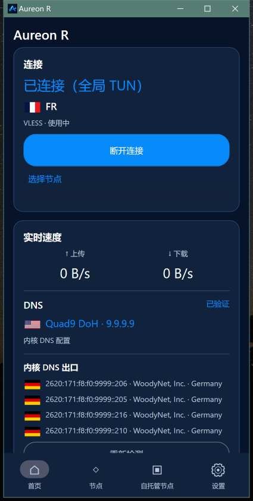
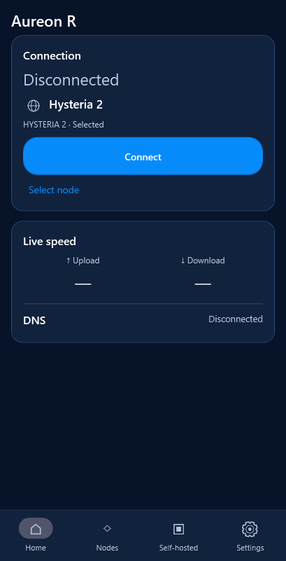
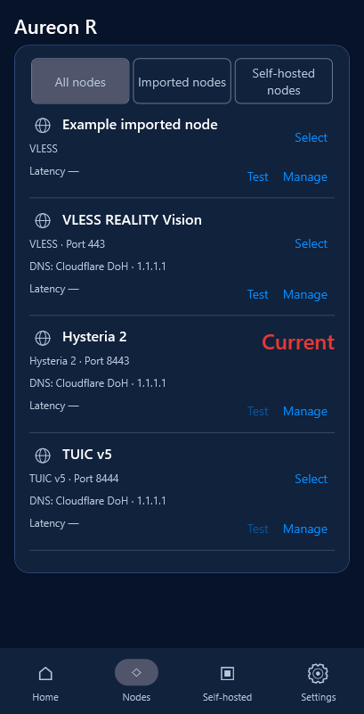
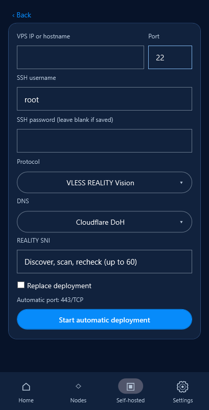
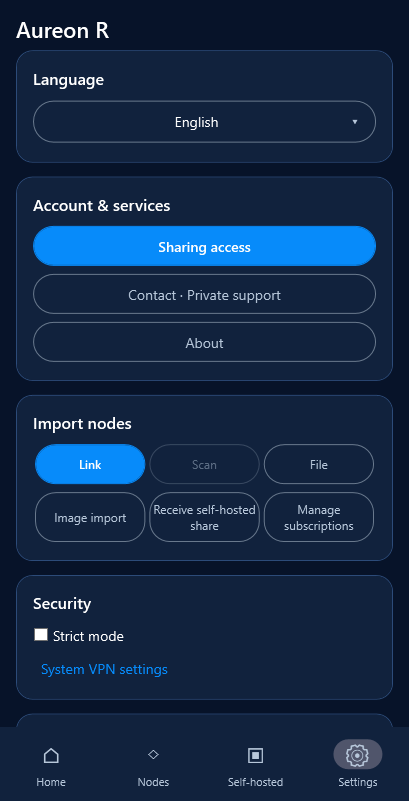

# Aureon R Windows v0.1.28

Aureon R is an independent proxy client that supports importing your own nodes and self-hosted VPS deployment. No official proxy nodes are provided.

## Key Features

- **Multi-protocol support:** Dual sing-box and Xray cores supporting VLESS Reality Vision, VMess TLS, Trojan TLS, Hysteria 1/2, TUIC v5, WireGuard and AnyTLS.
- **Node management:** Import links, text, files, QR code images and subscriptions. Manage, update and switch nodes. No registration is required for ordinary node use.
- **Routing & security:** Global proxy, application/domain/IP split routing, LAN bypass, strict mode, encrypted DNS (DoH) and leak protection.
- **Connection monitoring:** Real-time traffic, node latency, IP-based country and region flags, and DNS resolution verification.
- **Self-hosted deployment:** One-click Debian VPS deployment via SSH, automatic Docker and firewall configuration, and support for adding protocols, redeployment and removal.
- **Node sharing:** Share nodes via QR codes and links, with independent guest credentials, guest management and access revocation. Sharing access requires approval.
- **Backup & restore:** Encrypted backups and incremental restoration using the same account.
- **Desktop experience:** Chinese and English interface, system tray, account management, private support messaging and update checks.

## What's new in v0.1.28

- Improved leak protection and network recovery.
- Added IP-based country and region flags for nodes and DNS.
- Improved DNS resolution verification.

## Installation

Supports Windows 10/11 x64, with the .NET runtime included. In-place upgrades are supported. Exit the previous version from the system tray before installing. The EXE is not Authenticode-signed; Windows may show an unknown-publisher warning. Verify the SHA-256 checksum before running it.

---

## Screenshots

Actual Windows 0.1.28 connection (Chinese UI; local connection details masked):

English interface previews rendered from version 0.1.28 using test data:

| Home | Nodes |
| :---: | :---: |
|  |  |

| Self-hosted deployment | Settings |
| :---: | :---: |
|  |  |

## Links

- [Official website](https://aureonvpn.com/en/aureon-r)
- [User guide](https://aureonvpn.com/en/aureon-r/app-guide)
- [Support](https://aureonvpn.com/en/aureon-r/contact)

## Third-party components

- [sing-box 1.14.4 — GPL-3.0](https://github.com/SagerNet/sing-box/tree/v1.14.4)
- [Xray-core 26.10.31 — MPL-2.0](https://github.com/XTLS/Xray-core/tree/v26.10.31)
- IP Geolocation by DB-IP — CC BY 4.0.

See the accompanying third-party notices and SHA-256 checksum file.

[简体中文](RELEASE-NOTES.zh-CN.md)
