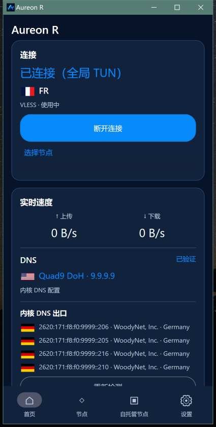
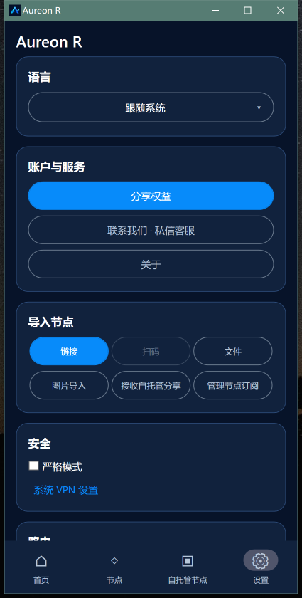
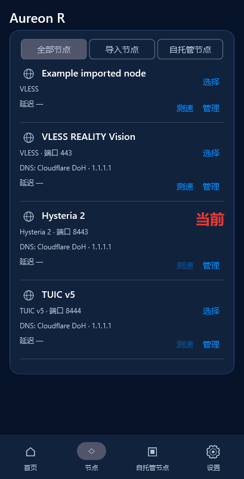
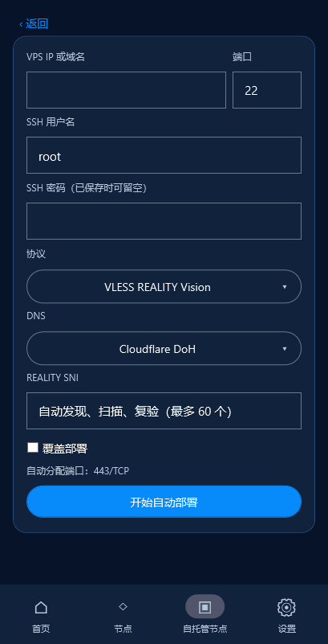

# Aureon R Windows v0.1.28

Aureon R 是独立代理客户端，支持用户自行导入节点及 VPS 自托管部署，不提供官方代理节点。

## 主要功能

- **多协议支持：** sing-box 与 Xray 双内核，支持 VLESS Reality Vision、VMess TLS、Trojan TLS、Hysteria 1/2、TUIC v5、WireGuard、AnyTLS。
- **节点管理：** 支持链接、文本、文件、二维码图片及订阅导入，节点管理、更新与切换，普通节点使用无需注册。
- **路由与安全：** 全局代理、应用/域名/IP 分流、局域网绕过、严格模式、DoH 加密 DNS 及防泄漏保护。
- **连接监控：** 实时流量、节点延迟、IP 地区旗帜及 DNS 解析验证。
- **自托管部署：** SSH 一键部署 Debian VPS，自动配置 Docker 和防火墙，支持多协议追加、覆盖及删除部署。
- **节点分享：** 支持二维码和链接分享、独立访客凭据、访客管理及权限撤销。分享权益需申请开通。
- **备份与恢复：** 加密备份及同账号增量恢复。
- **桌面体验：** 中英文界面、系统托盘、账户管理、私信客服及更新检查。

## v0.1.28 更新内容

- 完善防泄漏机制及网络恢复。
- 新增节点与 DNS 的 IP 地区旗帜。
- 完善 DNS 解析验证。

## 安装说明

支持 Windows 10/11 64 位，内置 .NET 运行环境。支持覆盖升级，安装前请从系统托盘退出旧版。安装包尚未进行 Authenticode 数字签名，Windows 可能显示未知发布者提示，运行前请核对 SHA-256。

---

## 界面介绍

实际运行 Windows 0.1.28 的连接首页和设置页（本地连接信息已遮盖）：

| 连接首页 | 设置 |
| :---: | :---: |
|  |  |

以下为同版本使用示例数据生成的界面预览：

| 节点管理 | 自托管部署 |
| :---: | :---: |
|  |  |

## 相关链接

- [官网](https://aureonvpn.com/aureon-r?lang=zh)
- [使用指南](https://aureonvpn.com/aureon-r/app-guide?lang=zh)
- [联系我们](https://aureonvpn.com/aureon-r/contact?lang=zh)

## 第三方组件

- [sing-box 1.14.4 — GPL-3.0](https://github.com/SagerNet/sing-box/tree/v1.14.4)
- [Xray-core 26.10.31 — MPL-2.0](https://github.com/XTLS/Xray-core/tree/v26.10.31)
- IP 地理位置数据由 DB-IP 提供 — CC BY 4.0。

请参阅随附的第三方许可证说明及 SHA-256 校验文件。

[English](RELEASE-NOTES.en.md)
